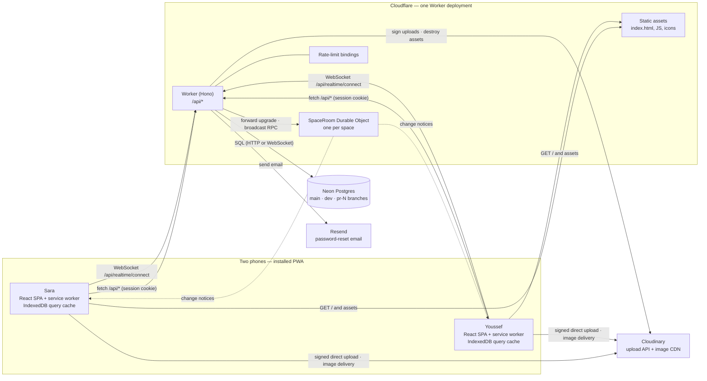
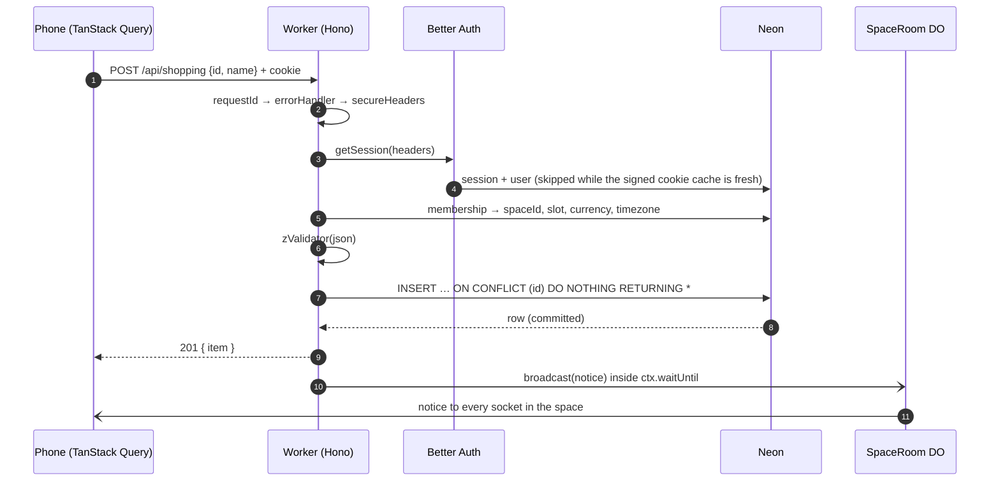
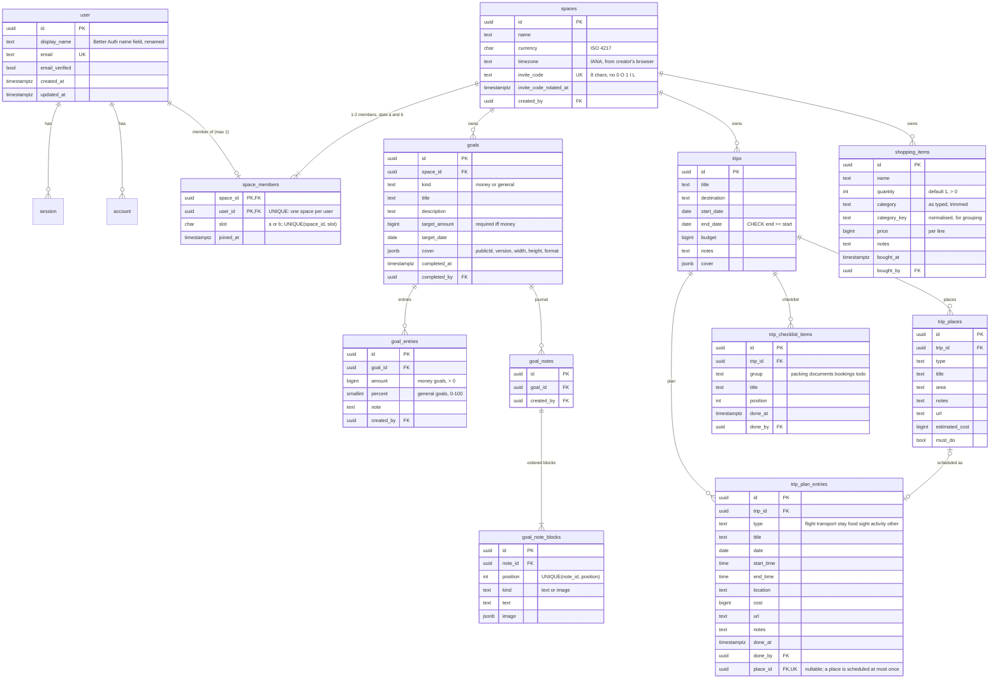
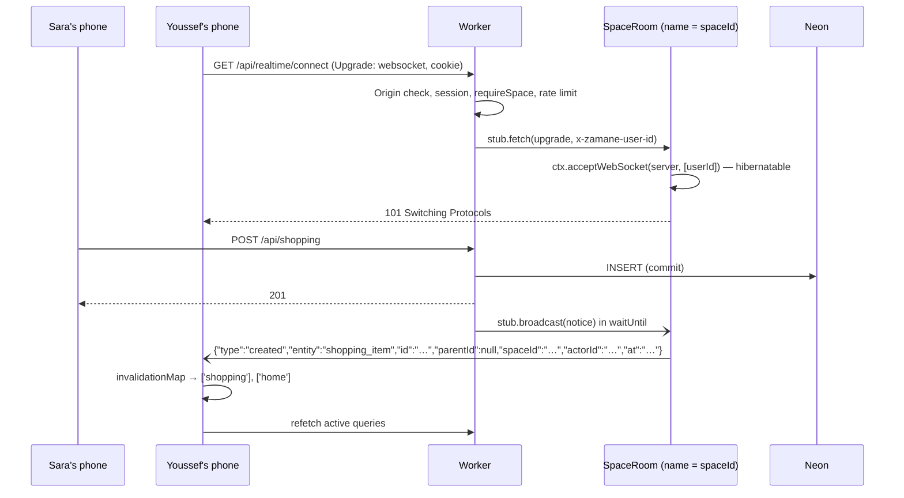
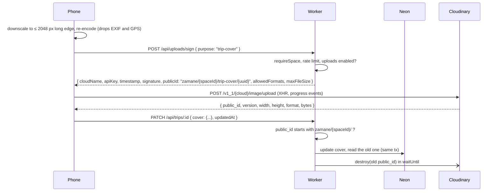

# Zamane — Architecture

Zamane is a private, mobile-first PWA for exactly two people. This document describes the plumbing: runtime, data, API, auth, realtime, uploads, offline and environments. It is the contract the code follows; when the code changes shape, this file changes in the same commit.

> Status: **Phase 0 (plan)**. Nothing below is built yet. Versions were checked on 2026-11-09.

---

## 1. Context



- **One origin.** The SPA and the API are served by the same Worker. Static files come from Workers static assets; only `/api/*` runs Worker code (`assets.run_worker_first: ["/api/*"]`), and unknown paths fall back to `index.html` (`not_found_handling: "single-page-application"`). There is no CORS setup and no third-party cookie.
- **One Durable Object per space** (`getByName(spaceId)`) holds the two phones' WebSockets and fans out change notices. It's SQLite-backed, declared through `exports` (D27), and stores no domain data.
- **Postgres is the only source of truth.** The socket carries change notices, never data.
- **Image bytes never touch the Worker.** Phones upload straight to Cloudinary with a short-lived signature from the Worker.

## 2. Repository layout

The layout from the brief, with one package and one `tsconfig` per runtime:

```
src/client/      React SPA: routes/, lib/{api,query,realtime,upload}.ts, assets/brand/, sw.ts
src/worker/      Hono app: index.ts, env.ts, auth.ts, db/{schema,client}.ts,
                 middleware/, routes/, services/, realtime/SpaceRoom.ts
src/shared/      Zod schemas, enums, money, cloudinary URL builder, trip-day logic
drizzle/         generated SQL migrations (committed)
scripts/         icons, dev-vars sync (if needed), seed, db guard, orphan finder, secret grep
assets/          logo sources — read-only
public/          generated icons (output of `pnpm icons`, committed)
tests/           unit/, api/, e2e/
```

- `tsconfig.json` references `tsconfig.client.json` (DOM libs), `tsconfig.worker.json` (types from `wrangler types`) and `tsconfig.node.json` (Vite config and scripts). `src/shared` is included by both runtimes and must not import from either.
- Route handlers are thin. They validate, call one service or repository function with `spaceId` from context, and broadcast. Rules (completion, stats, budget, trip status, invite codes, category normalisation) are plain functions in `src/worker/services/` or `src/shared/`, with unit tests.

## 3. Request lifecycle



**Middleware order** (outermost first): `requestId` → `errorHandler` (`app.onError` + `notFound`) → `secureHeaders` → `rateLimit` (selected routes) → `session` → `requireSpace` (space-scoped routes only).

- `session` resolves the Better Auth session once and sets `c.var.user`. No session means `401 { error: { code: "unauthenticated" } }`.
- `requireSpace` runs one query (`space_members ⋈ spaces` by `user_id`) and sets `c.var.space = { spaceId, userId, slot, currency, timezone }`. A user without a space gets `403 no_space`. Only `/api/me`, `/api/spaces` (create and join) and the auth routes work without a space.
- **Every repository function takes `spaceId` as its first argument** and every statement filters on it. Ids are never trusted on their own: a row id from another space behaves exactly like a missing id (`404 not_found`).
- **Errors** always have the shape `{ error: { code, message, fields? } }`. Zod failures map to `400 validation_failed` with `fields` keyed by path. Unexpected errors map to `500 internal` and are logged with the request id, never with env values or SQL parameters.

## 4. Data model

### Conventions

| Concern | Rule |
|---|---|
| Primary keys | UUID v7 generated in the app (`uuid` package), column type `uuid`. Creates accept a client-generated id. |
| Instants | `timestamptz`. `updated_at` uses **millisecond precision** (`timestamptz(3)`) so the `updatedAt` a client echoes back compares equal. |
| Calendar days, clock times | `date` and `time` (no time zone). |
| Money | `bigint` minor units, read into JS as `number` (safe-integer checked). The currency is an ISO 4217 code on the space. |
| Enums | `text` + `CHECK` built from `as const` arrays in `src/shared/enums.ts`, so the DB, the Zod schemas and the TS types share one list. Adding a value is a one-line migration. |
| Space ownership | Every space-owned table has `space_id` (FK `ON DELETE CASCADE`), `created_by`, `created_at`, `updated_at`, and an index on `space_id`. |
| Parent integrity | Child rows reference their parent with a **composite FK** `(parent_id, space_id) → parent(id, space_id)`, so a child can never point at another space's parent, even if a handler has a bug. |
| Derived values | Never stored. Computed in SQL or services (§4.3). The only stored "result" is `goals.completed_at/by`, which records *when* a goal crossed its target and is recomputed in the same transaction as every write that can change it. |

### ERD



Every space-owned table also carries `space_id`, `created_by`, `created_at` and `updated_at`. They're left out of the diagram above to keep it readable.

### 4.1 Constraints that carry product rules

- **Two members, never three.** `UNIQUE(space_id, slot)` with `slot ∈ {a, b}` makes a third member impossible, even under concurrent joins. `UNIQUE(user_id)` limits each user to one space. The creator takes slot `a`. Joining is one statement, `INSERT INTO space_members SELECT s.id, $user, 'b' FROM spaces s WHERE s.invite_code = $code ON CONFLICT DO NOTHING RETURNING space_id`, so the constraint does the arbitration. Zero rows returned means the code is unknown or the space is full, and both cases get the same `404 invite_invalid`, so a guess can't tell them apart.
- **Goal kind.** CHECK: `kind = 'money'` ⇒ `target_amount > 0`; `kind = 'general'` ⇒ `target_amount IS NULL`. `(completed_at IS NULL) = (completed_by IS NULL)`. Entries hold exactly one of `amount` or `percent`, and the service rejects an entry whose field doesn't match the goal's kind. `kind` can't be changed after creation.
- **Places are scheduled at most once.** `trip_plan_entries.place_id` is `UNIQUE`, `ON DELETE SET NULL`. Deleting a place keeps the plan entry. Deleting the plan entry "unschedules" the place.
- **Trip dates.** Both dates are null, or both are set with `end_date >= start_date` (see D12).
- **Note blocks.** `kind = 'text'` ⇒ `text` is set and `image` is null; `kind = 'image'` ⇒ `image` is set.
- **Text caps** live in the Zod schemas (titles 120, names 120, notes and descriptions 4 000, note text blocks 10 000, URLs 2 048 and `http(s)` only) and are mirrored by `CHECK (char_length(...) <= n)` on the same columns.

### 4.2 Indexes

`space_id` on every space-owned table, plus `goal_entries(goal_id, created_at)`, `goal_notes(goal_id)`, `goal_note_blocks(note_id, position)`, `trip_plan_entries(trip_id, date, start_time)`, `trip_places(trip_id)`, `trip_checklist_items(trip_id, "group", position)`, `shopping_items(space_id, bought_at)` and `shopping_items(space_id, category_key)`.

### 4.3 Derived values (queries and services, never stored)

| Value | Definition |
|---|---|
| Money goal progress | `sum(goal_entries.amount)` |
| General goal progress | `percent` of the latest entry (`ORDER BY created_at DESC, id DESC LIMIT 1`); 0 with no entries |
| Completion | Money: `progress >= target_amount`. General: `progress = 100`. Crossing up sets `completed_at = now()` and `completed_by = actor`. Dropping back below clears both. `services/completion.ts` decides this, called inside the same transaction as entry insert, entry delete and target change, with the goal row locked `FOR UPDATE` so two partners adding at once are serialised. |
| Home total saved | `sum(amount)` over all money-goal entries in the space, completed goals included |
| Goal stats | count, total, average, max, this-month total (month boundaries in `spaces.timezone`: `created_at AT TIME ZONE tz >= date_trunc('month', now() AT TIME ZONE tz)`), last activity, and a per-member breakdown joined to `space_members.slot` |
| Trip budget | `Σ plan.cost + Σ place.estimated_cost` over places with **no** linked plan entry, also grouped by `type`, plus `overBudget = budget IS NOT NULL AND planned > budget`. Scheduling a place pre-fills the new plan entry's `cost` from the place's estimate, so the estimate keeps counting exactly once (D11). |
| Place "visited" | `EXISTS (plan entry with place_id = place.id AND done_at IS NOT NULL)` |
| Trip status, "now / next", day list | Computed **on the client** from the device's local date and time by `src/shared/trip-days.ts`: upcoming (days until `start_date`), happening now, past, or unscheduled. The day list runs from `start_date` to `end_date` inclusive, with empty days kept. Entries dated outside the range go into an "outside trip dates" group, and undated entries into "unscheduled". The server returns raw `date` and `time` strings. |
| Shopping groups | Unbought items grouped by `category_key` (null = "Other"), each with a price subtotal. Bought items form a separate "done" group. |
| Category suggestions | `SELECT DISTINCT ON (category_key) category … ORDER BY category_key, updated_at DESC`, the latest spelling for each key |

**Category normalisation** (`src/shared/category.ts`, used by both client and server): NFKD, strip diacritics, lower-case, remove all whitespace. So "Fruit & Veg", "fruit &veg" and "Frúit & veg" share one key. On write, if the key already exists in the space, the server stores the existing spelling, so groups don't split.

**Money** (`src/shared/money.ts`): an explicit ISO 4217 minor-unit table (2 by default; 0 for JPY, KRW, XOF, XAF, …; 3 for BHD, KWD, TND, …). Not `Intl`, whose CLDR digits differ from ISO for a few currencies and could change under us. `parseMoney("12,50", "EUR") → 1250`, `formatMoney(1250, "EUR", locale)` uses `Intl.NumberFormat` with the fraction digits fixed from the table. No floats on any path.

### 4.4 Seed

`pnpm db:seed` (guarded, see §10) creates Sara and Youssef with known dev passwords and a shared space (EUR, `Europe/Brussels`). It adds a money goal with entries from both, a completed money goal, a general goal at 60%, a trip with plan entries across three days (one empty day, one entry dated outside the range), places (one scheduled, one must-do) and a seeded checklist, plus a shopping list with categories and one bought item. Tests reuse the same fixture builders.

## 5. API

Hono under `/api`, with every input validated by `@hono/zod-validator` against schemas in `src/shared/schemas/`. Route modules are chained and mounted with `app.route()`, so `AppType` carries every route to `hono/client`.

| Group | Endpoints |
|---|---|
| Public | `GET /api/health` (DB round trip, never shows the URL) · `GET /api/config` → `{ uploadsEnabled, cloudinaryCloudName }` · `GET /api/password-reset/check?token=` → `{ valid }` (expired and used look the same; rate-limited, D37) |
| Auth | `/api/auth/*` → Better Auth handler, behind a gate (D38): only sign-up, sign-in, sign-out, get-session, request-password-reset, reset-password and change-password are reachable |
| Me | `GET /api/me` → `{ user: { id, displayName, email }, space: null | { id, name, currency, timezone, slot, memberCount } }` · `PATCH /api/me` (display name) |
| Spaces | `POST /api/spaces` (create; takes `{ id, name, currency, timezone }`; `409 already_in_space`) · `POST /api/spaces/join` `{ code, replaceSolo? }` → `{ space, partnerName }` (`404 invite_invalid`, `409 already_in_space`, `409 partner_joined`; a retry by a member of that space answers `200`, D37; `replaceSolo`, D33) · `GET /api/spaces/mine` (space, members with slot and display name, invite code) · `GET /api/spaces/mine/summary` → `{ goals, trips, items }` (the switch's confirmation) · `POST /api/spaces/mine/invite-code` (rotate) · `POST /api/spaces/mine/leave` → **stubbed `501`** for v1 (see D19) |
| Home | `GET /api/home`: total saved, open-goal progress, the closest-to-done goals, next trip (raw dates), shopping items left, and goals for quick add. One SQL statement built from CTEs. |
| Goals | `GET/POST /api/goals` · `GET/PATCH/DELETE /api/goals/:id` · `GET/POST /api/goals/:id/entries` · `DELETE /api/goals/:id/entries/:entryId` · `GET /api/goals/:id/stats` · `GET/POST /api/goals/:id/notes` · `PUT/DELETE /api/goals/:id/notes/:noteId` (saves the whole note: ordered blocks) |
| Trips | `GET/POST /api/trips` · `GET/PATCH/DELETE /api/trips/:id` · `…/plan` (+ `PATCH/DELETE …/plan/:entryId`, `PUT …/plan/:entryId/done`) · `…/places` (+ `PATCH/DELETE`) · `POST …/places/:placeId/schedule` · `…/checklist` (+ `PATCH/DELETE`, `PUT …/checklist/:itemId/done`) · `GET …/budget` |
| Shopping | `GET/POST /api/shopping` · `PATCH/DELETE /api/shopping/:id` · `PUT /api/shopping/:id/bought` `{ bought: boolean }` · `POST /api/shopping/clear-bought` · `GET /api/shopping/categories` |
| Uploads | `POST /api/uploads/sign` `{ purpose }` |
| Realtime | `GET /api/realtime/connect` (WebSocket upgrade) |

**Write semantics**

- **Idempotent creates.** The body carries the client's UUID. `INSERT … ON CONFLICT (id) DO NOTHING RETURNING *`. When nothing comes back, the server re-reads the row *in the caller's space*: if it exists, it answers `200` with it (a replay); otherwise it's an id collision with another space and gets `409 id_conflict`.
- **Ticks set state; they don't toggle.** `PUT …/bought { bought: true }` and `PUT …/done { done: true }` can be replayed any number of times with the same result, which offline replay needs (D9).
- **Optimistic concurrency.** `PATCH` and `PUT` on editable records take `updatedAt`. `UPDATE … WHERE id = $1 AND space_id = $2 AND updated_at = $3 RETURNING *`. Zero rows means one more read: the row exists, so `409 conflict` with the current row in the body (the client shows it and lets the user re-apply); or it doesn't, so `404`. Set-state ticks and offline mutations skip the check, so the last write wins (documented per endpoint).
- **Idempotent deletes.** `DELETE` answers `204` whether or not the row existed in the caller's space. It reveals nothing about other spaces and is safe to retry.
- **Broadcast after commit.** Every mutation calls `broadcast(c, notice)` after its statement or transaction has committed. That function runs `ctx.waitUntil(stub.broadcast(notice).catch(log))`, so a broadcast failure never fails the request.
- **Rate limits** (Workers Rate Limiting binding, keyed per IP and per user or email): sign-in, sign-up and password reset (10/min), join by code (5/min per user and per IP), upload signing (30/min per user), realtime connect (20/min per user). A refusal is `429 { error: { code: "rate_limited" } }` with `Retry-After: 60` (D37).

**Transactions.** `src/worker/db/client.ts` exposes `db(c)`, a module-level Drizzle client on the Neon HTTP driver for single statements and non-interactive batches, and `withTx(c, fn)`, which creates a WebSocket `Pool` for this request, runs `db.transaction(fn)` and closes the pool in `ctx.waitUntil(pool.end())`. Interactive transactions are used for: goal entry insert and delete, and target changes (completion recompute); note save (replacing blocks plus the optimistic check); and cover replacement (read the old asset, write the new one). Everything else is a single statement or an `atomic(c, [...])` call (trip create plus checklist seed; space create plus first member). On the HTTP driver, `atomic` maps to `db.batch`, which runs as one non-interactive transaction, so moving to Hyperdrive later (D2) changes only `db/client.ts`.

## 6. Auth

Self-hosted **Better Auth** inside the Worker (D1), mounted with `app.all("/api/auth/*", c => auth.handler(c.req.raw))`. Sessions and accounts live in Postgres through the Drizzle adapter.

- **Instance**: `createAuth(env, ctx)` builds a Better Auth instance per request (bindings arrive per request), following Hono's Workers example. It uses the HTTP Drizzle client: the adapter's `transaction` option defaults to `false`, so the HTTP driver's lack of interactive transactions doesn't matter. A separate `auth.config.ts` with the same options feeds the schema CLI (`npx auth generate`) in Node. Its output is checked against `db/schema.ts`, which stays hand-owned.
- **Email + password** only. Sign-up takes email, password (min 10, max 128) and display name. The display name is Better Auth's `name` field, mapped to the `display_name` column (D7). `advanced.database.generateId` returns UUID v7, so auth ids are `uuid` columns like the rest of the schema.
- **Cookies and CSRF**: Better Auth issues httpOnly, `SameSite=Lax` cookies on our own origin, `Secure` whenever the base URL is https (every environment except local). Its CSRF defences stay on: an origin check against `BETTER_AUTH_URL` (no extra `trustedOrigins` needed on one origin) and Fetch-Metadata checks on sign-in. Every other state-changing `/api` call is same-origin JSON. A cross-site form post loses twice: `SameSite=Lax` withholds the cookie, and the JSON content-type check rejects the body.
- **Session cache**: `session.cookieCache` (5 min, signed) skips the session query on most requests. The cost is that a revoked session (password change or reset) can keep working on another device for up to 5 minutes, which is acceptable here. `advanced.ipAddress.ipAddressHeaders = ["cf-connecting-ip"]`.
- **Password reset**: `POST /api/auth/request-password-reset` gives the same response whether or not the email exists, and Better Auth runs a dummy lookup. The email is sent from `ctx.waitUntil`, not awaited, so timing doesn't reveal it either. The token is single-use and expires after 1 hour (`resetPasswordTokenExpiresIn: 3600`). `revokeSessionsOnPasswordReset: true` is set explicitly (it's off by default). The link goes to `${APP_URL}/reset-password?token=…`.
- **Email**: `sendEmail({ to, subject, text, html })` in `src/worker/services/email.ts`. The Resend implementation calls the HTTP API with `fetch`, so there's no SDK. When `APP_ENV=development` and `RESEND_API_KEY` is empty, a dev logger prints the reset link to the Worker console instead. It never returns it in an HTTP response.
- **Rate limits**: Better Auth's own limiter is off. The Workers binding covers sign-in, sign-up, password reset and change-password, keyed by IP and email (D26).
- **Password hashing** cost on Workers: see D3.

## 7. Realtime



**Server.** `SpaceRoom` is a SQLite-backed Durable Object class (free-plan eligible, declared through `exports`, D27) using the WebSocket Hibernation API:

- `fetch()` accepts the upgrade with `ctx.acceptWebSocket(ws, [userId])`.
- `broadcast(notice)` is an RPC method that sends to `ctx.getWebSockets()`.
- `setWebSocketAutoResponse("ping" → "pong")` answers keep-alives without waking the object.

The Worker checks the `Origin` header before forwarding, which guards against cross-site WebSocket hijacking because the browser sends the cookie on the handshake. The socket is authorised once, at connect. Notices carry only `{ type, entity, id, parentId?, spaceId, actorId, at }`, so a stale socket can leak only "something changed". Logout closes it from the client.

**Client** (`src/client/lib/realtime.ts`):

- Connect after login.
- Reconnect with exponential backoff and jitter (1 s → 30 s).
- On every (re)connect and on `visibilitychange → visible`, invalidate active queries.
- While the socket is down, the default `refetchInterval` switches to 30 s (a slow poll); TanStack Query's `refetchOnWindowFocus` and `refetchOnReconnect` stay on.
- One `invalidationMap: Record<Entity, (n) => QueryKey[]>` turns a notice into keys. For example, `goal_entry` maps to the goal's detail, entries and stats keys, plus the goal list and `['home']`.
- **Own echoes**: each mutation records `entity:id` in a short-lived set (15 s). A notice whose `actorId` is me *and* whose `entity:id` is in that set is skipped, because the optimistic update already covers it. The same user's other device doesn't have the id in its set, so it still refreshes.

## 8. Images (Cloudinary)



- **Signing** uses Web Crypto (SHA-256 over the sorted parameters plus the secret, `signature_algorithm=sha256`). The signature pins `public_id`, `timestamp`, `allowed_formats` (jpg, png, webp, heic, avif) and `overwrite=false`, so the phone can't choose its own path (D8). The server still checks the prefix on save. A signature is valid for Cloudinary's standard one-hour window.
- **Size**: the phone enforces `maxFileSize` (10 MB) after downscaling. Whether Cloudinary can enforce a per-upload byte cap from signed parameters is verified in Phase 6; if it can't, the save step checks `bytes` and rejects oversized uploads (deleting the asset).
- **Delivery**: `src/shared/cloudinary.ts` exports `imageUrl(asset, { w, h?, dpr })`, which builds `f_auto,q_auto,c_fill,g_auto,w_{w*dpr}` URLs pinned to `v{version}`. The arch-shaped crop is CSS.
- **Cleanup**: replacing or deleting a cover or image block destroys the old asset (signed `destroy`) inside `ctx.waitUntil`. Deleting a goal or trip destroys all its assets. `pnpm images:orphans` lists the assets under each `zamane/{spaceId}/` prefix with the Admin API, diffs them against the DB, and prints orphans (`--delete` removes them).
- **Disabled mode**: when all three Cloudinary keys are empty, `/api/uploads/sign` returns `503 uploads_disabled`, `/api/config` reports `uploadsEnabled: false`, and the client hides every upload control. Covers fall back to the title's initial in the arch, and journal notes accept text blocks only. Both modes are tested.
- Uploads need a connection. They are not queued offline in v1.

## 9. PWA, offline and sync

**Manifest**: name and short name "Zamane", `display: standalone`, `start_url: /`, `scope: /`, `theme_color: #1d4e89`, `background_color: #f8f3ea`. `index.html` also sets `<meta name="theme-color">` per colour scheme (light `#f8f3ea`, dark `#12161d`, from the design tokens). Icons are generated by `pnpm icons` from `assets/zamane-app-icon.svg`: `favicon.ico`, `favicon.svg`, `apple-touch-icon-180x180.png`, `pwa-192x192.png`, `pwa-512x512.png` and `maskable-icon-512x512.png`. For the maskable icon, the script measures the lettering's bounding box and pads with majorelle `#1d4e89` until the lettering sits inside the central 80% circle.

**Service worker** (`src/client/sw.ts`, `vite-plugin-pwa` in `injectManifest` mode):

- `precacheAndRoute(self.__WB_MANIFEST)` covers the app shell.
- A `NavigationRoute` falls back to `index.html`, with a denylist of `^/api/`.
- `res.cloudinary.com/{cloud}/image/*` uses `StaleWhileRevalidate` with `ExpirationPlugin` (200 entries, 30 days) and `CacheableResponsePlugin` (status 0 and 200).
- **`/api/*` is never cached by the service worker.** TanStack Query's persisted cache owns data.
- `registerType: "prompt"`: a waiting worker shows "New version available — Reload", which posts `SKIP_WAITING` and then reloads. There is no silent `skipWaiting`.

**Offline reads.** `PersistQueryClientProvider` uses `createAsyncStoragePersister` over `idb-keyval`, with `maxAge` 7 days and `buster = ${APP_VERSION}:${userId}`. Logout runs `queryClient.clear()`, removes the persisted client and closes the socket.

**Offline writes.** These work offline:

| Mutation key | Endpoint |
|---|---|
| `['shopping','add']` | `POST /api/shopping` |
| `['shopping','setBought']` | `PUT /api/shopping/:id/bought` |
| `['goalEntries','add']` | `POST /api/goals/:id/entries` |
| `['checklist','setDone']` | `PUT /api/trips/:id/checklist/:itemId/done` |
| `['plan','setDone']` | `PUT /api/trips/:id/plan/:entryId/done` |
| `['places','add']` | `POST /api/trips/:id/places` |

Each key has `queryClient.setMutationDefaults(key, { mutationFn, onMutate, onError, onSettled })`, defined in one module that loads before the persisted cache is restored, so paused mutations rehydrated from IndexedDB find their `mutationFn`. Variables are JSON-only and carry the client-generated id. `onMutate` writes the optimistic row, `onError` rolls back, and `onSettled` invalidates. After restore, `onSuccess: () => queryClient.resumePausedMutations()` replays the queue in order. Every other mutation needs a connection: an `useOnline()` hook disables those controls and says why.

## 10. Environments, configuration and secrets

### Keys

| Key | Where it lives | Notes |
|---|---|---|
| `DATABASE_URL` | `.env` · CI (Neon branch output) · Wrangler secret | **Direct (unpooled)** endpoint, `sslmode=require`. Used by the Worker (HTTP + WebSocket drivers) and by drizzle-kit. |
| `BETTER_AUTH_SECRET` | `.env` · GitHub secret · Wrangler secret | ≥ 32 random bytes (`openssl rand -base64 32`) |
| `BETTER_AUTH_URL` | `.env` · `vars` | Optional; defaults to `APP_URL` (same origin) |
| `APP_URL` | `.env` · `vars` | Public origin; `http://localhost:3000` locally |
| `RESEND_API_KEY` | `.env` · Wrangler secret | Empty locally → dev email logger |
| `EMAIL_FROM` | `.env` · `vars` | e.g. `Zamane <hello@your-domain>`; the domain must be verified in Resend. Required once `RESEND_API_KEY` is set (D39) |
| `CLOUDINARY_CLOUD_NAME` | `.env` · `vars` | All three Cloudinary keys or none |
| `CLOUDINARY_API_KEY` | `.env` · Wrangler secret | |
| `CLOUDINARY_API_SECRET` | `.env` · Wrangler secret | Server only |
| `APP_ENV` | `wrangler.jsonc` `vars` per environment | `development` (top level) · `preview` · `production` |
| `NEON_API_KEY`, `NEON_PROJECT_ID` | GitHub secret / variable; optionally `.env` | CI branch create and delete; also lets the local DB guard look up the branch name |

- **Nothing server-side has a `VITE_` prefix.** The client learns `uploadsEnabled` and `cloudinaryCloudName` from `GET /api/config`.
- **`src/worker/env.ts`** parses the bindings with Zod once per isolate, on first use (Workers have no startup hook), and throws a startup error that names missing or invalid keys, never their values. The Cloudinary keys are all-or-nothing: all empty means uploads are disabled, and a partial set is an error naming the missing key. A `-pooler` host in `DATABASE_URL` logs a warning.
- **`NODE_ENV` stays out of `.env`.** Vite reads `NODE_ENV` from `.env` files, and `NODE_ENV=development` there makes `vite build` emit a development bundle. The Worker's environment comes from `APP_ENV`, which `wrangler.jsonc` sets per environment.
- **Local `.env` → Worker**: `vite dev` loads `.env` straight into the Worker's bindings (D20). Vite exposes only `VITE_*` keys to the client, and there are none. **There must be no `.dev.vars` file**, because its presence switches `.env` loading off.

### Production secrets

Non-secret settings (`APP_ENV`, `APP_URL`, `BETTER_AUTH_URL`, `EMAIL_FROM`, `CLOUDINARY_CLOUD_NAME`) are `vars` under `env.production` in `wrangler.jsonc`. Secrets are set once per environment, never in committed config:

```sh
pnpm wrangler secret put DATABASE_URL          --env production
pnpm wrangler secret put BETTER_AUTH_SECRET    --env production
pnpm wrangler secret put RESEND_API_KEY        --env production
pnpm wrangler secret put CLOUDINARY_API_KEY    --env production
pnpm wrangler secret put CLOUDINARY_API_SECRET --env production
pnpm wrangler secret list --env production     # names only, to check
```

### Branches and deployments

| | Neon | Cloudflare |
|---|---|---|
| Production | `main` (protected) | Worker `zamane` (`--env production`) |
| Local | `dev`, your `.env` | `pnpm dev` (Vite + workerd) on `:3000` |
| Pull request | `pr-{number}`, created by CI, deleted on close | Preview Worker (D25) |

- **Migrations** are generated with `drizzle-kit generate`, committed, and applied with `drizzle-kit migrate` in CI before the Worker deploys. Destructive changes follow expand → deploy → contract across two releases.
- **Guard** (`scripts/db-guard.ts`) runs before `db:seed`, `db:migrate` when pending migrations contain `DROP` / `TRUNCATE` / `ALTER … DROP`, and `db:studio` writes. It refuses unless `APP_ENV` (default `development` for local scripts) is `development` **and** the Neon branch behind `DATABASE_URL` is not `main`, not the project default and not protected. The branch is looked up through the Neon API from the endpoint id in the host. Without `NEON_API_KEY` it can't look the branch up, so it refuses and says so.

### Scripts

`dev` · `build` · `preview` · `deploy` · `icons` · `db:generate` · `db:migrate` · `db:seed` · `db:studio` · `test` · `test:e2e` · `lint` · `typecheck` · `images:orphans` · `check:secrets`

## 11. Testing and CI

- **Unit** (Vitest, Node): money, category normalisation, invite codes, completion, stats, budget, trip status and day list, the invalidation map, env validation (Cloudinary all-or-nothing).
- **API** (Vitest with `@cloudflare/vitest-pool-workers`, inside workerd against a Neon branch): auth flows; create and join (the concurrency test fires 10 parallel joins at one code, and exactly one succeeds); cross-space isolation (reads, writes and deletes against another space's ids return 404, 404 and 204-with-no-effect); idempotent create replay; 409 on stale `updatedAt`; completion and un-completion; budget with scheduled and unscheduled places; uploads in both modes.
- **E2E** (Playwright): two browser contexts, Sara and Youssef. Sara adds a shopping item and Youssef sees it within 2 s without a reload. A second spec covers offline: add an item offline, go online, and the item syncs.
- **CI** (GitHub Actions) on each pull request:
  1. install, lint, typecheck, unit tests;
  2. create Neon branch `pr-N` (schema-only from `main`, D31; `neondatabase/create-branch-action@v6`), then migrate and seed;
  3. API tests, build, then `check:secrets`, which fails if the client bundle (`dist/client`) contains the string `CLOUDINARY_API_SECRET` or `postgres://` / `postgresql://`, if any file in `dist/` contains a secret value, or if the Worker code contains the test-only route (D34);
  4. E2E against `vite preview`;
  5. deploy a Worker Preview (D25).

  On push to `main`: the same checks, then migrate `main` → `wrangler deploy --env production`. On PR close: `delete-branch-action@v3`, and the preview is removed.

## 12. Security checklist

- Same-origin httpOnly, Secure, `SameSite=Lax` session cookies, plus Better Auth's origin check.
- Membership is enforced in middleware **and** by every repository function's `spaceId` parameter **and** by composite FKs. Cross-space tests cover all three layers.
- Invite codes: 8 characters from `23456789ABCDEFGHJKMNPQRSTUVWXYZ` (31⁸ ≈ 8.5 × 10¹¹), shown as `XXXX-XXXX`, normalised on input (case, spaces, dashes). Guessing is rate-limited, codes are rotatable, and a full space rejects every code with the same error.
- Zod on every input, with length caps and `http(s)` URL validation. JSON bodies are capped at 64 KB.
- **CSP** (production `public/_headers` for the SPA; Hono `secureHeaders` for `/api`): `default-src 'self'`, `script-src 'self'`, `style-src 'self' https://fonts.googleapis.com`, `font-src https://fonts.gstatic.com`, `img-src 'self' data: blob: https://res.cloudinary.com`, `connect-src 'self' https://api.cloudinary.com`, `worker-src 'self'`, `manifest-src 'self'`, `frame-ancestors 'none'`, `base-uri 'self'`, `form-action 'self'`. Same-origin `wss:` is covered by `'self'` in current browsers; Phase 7 checks this on iOS Safari and Android Chrome.
- No secrets in the client bundle (`check:secrets` in CI). `.env`, `.env.*` (except `.env.example`) and `.dev.vars*` are git-ignored.
- Reset tokens are single-use and expire after 1 hour, and responses don't reveal whether an account exists.
- Logs never contain env values, cookies, passwords, tokens or SQL parameters.

## 13. Pinned versions (checked 2026-11-09)

Exact versions go in `package.json`, and pnpm writes the lockfile.

| Area | Packages |
|---|---|
| Build | `vite` 8.3.7 · `@vitejs/plugin-react` 6.3.0 · `typescript` **6.0.3** (D4) · `@cloudflare/vite-plugin` 1.68.0 (D28) · `wrangler` 4.158.0 |
| Client | `react` / `react-dom` 19.3.1 · `@tanstack/react-router` 1.170.46 + `@tanstack/router-plugin` 1.169.0 · `@tanstack/react-query` (+ persist-client, async-storage-persister) 5.107.1 · `idb-keyval` 6.3.0 · `react-hook-form` 7.91.0 · `@hookform/resolvers` 7.0.5 |
| Shared | `zod` 4.6.7 · `date-fns` 4.4.0 + `@date-fns/tz` 1.5.0 · `uuid` 14.0.3 |
| Worker | `hono` 4.13.17 (D29) · `@hono/zod-validator` 0.9.1 · `better-auth` 1.7.18 · `drizzle-orm` 0.45.4 · `drizzle-kit` 0.31.11 (D6) · `@neondatabase/serverless` 1.2.0 |
| PWA | `vite-plugin-pwa` 2.0.0 · `@vite-pwa/assets-generator` 2.0.0 · `workbox-*` 7.4.1 · `sharp` 0.35.5 |
| Quality | `vitest` **4.1.12** (D5) · `@cloudflare/vitest-plugin` 1.7.0 (D35; replaces the deprecated `@cloudflare/vitest-pool-workers` 0.23.0) · `@playwright/test` 1.65.0 · `eslint` 10.14.0 · `typescript-eslint` 8.72.1 · `eslint-plugin-react-hooks` 7.1.1 · `prettier` 3.9.10 |

Runtime: Node 22 (you have 22.18), pnpm 10. Worker `compatibility_date` is `2026-11-10`, the newest date the pinned workerd supports at scaffold time (D36), with `nodejs_compat`.

## 14. Decision log

| # | Decision | Why |
|---|---|---|
| D1 | **Self-hosted Better Auth (1.7.18) inside the Worker, not Neon Auth.** | Neon Auth is now "Managed Better Auth", and for this setup it loses on three counts. First, its auth server runs on a Neon domain. The SPA would call it cross-origin, with `SameSite=None` cookies on `*.neon.build` and 15-minute JWTs verified by our API, and Neon's own roadmap lists a "standalone frontend + backend" setup as *coming soon*. Second, password-reset emails always use Neon's templates, even with custom SMTP, and its reset SDK method is "not fully supported yet". Third, there are no custom hooks or options, and `additionalFields` isn't documented. Self-hosting gives same-origin `SameSite=Lax` httpOnly cookies, Resend with our own templates, and auth tables in our own Drizzle schema with real FKs, still branched by Neon. The price is D3 and keeping up with Better Auth security releases (a batch landed 2026-11-03, so pin ≥ 1.7.18). |
| D2 | **No Hyperdrive in v1.** Keep the Neon serverless driver: HTTP `neon()` for single statements and batches, and a per-request WebSocket `Pool` for interactive transactions. Revisit if transactional routes run above ~150 ms p95 in Workers Observability. | Neon's Workers guide now *recommends* Hyperdrive (with `pg` and the direct endpoint, updated 2026-10-09). It is free-plan eligible (100k queries a day) and makes interactive transactions cheap. For two users, the gain is about 50 ms on the few transactional writes. The costs are real: query caching must be switched off, or a partner's refetch can read a 60-second-old result; each per-PR preview needs its own Hyperdrive config, because configs are shared across previews otherwise; and the driver changes. The swap stays cheap: `db/client.ts` is the only file that knows the driver, and multi-statement writes go through one `atomic()` helper (a `batch` today, a `transaction` on `pg`). |
| D3 | **Workers Paid plan ($5/month) from the first deploy.** | Workers Free allows 10 ms of CPU per request. Better Auth hashes passwords with scrypt (N=16384, r=16). Since `@better-auth/utils` 0.4.1 it uses Workers' native `node:crypto` scrypt, which fixed the old "exceeded CPU time" failures, but that hash is still expected to cost more than 10 ms. Sign-up, sign-in and password changes would fail on Free. Paid allows 30 s by default. Phase 3 measures the real cost. Durable Objects (SQLite-backed), rate limiting and Hyperdrive work on both plans. |
| D4 | **TypeScript 6.0.3, not 7.0.2.** | `typescript-eslint` 8.72 supports `typescript >=4.8.4 <6.1.0`. TS 7 (the native compiler) can be added later as a fast `typecheck` once linting supports it. |
| D5 | **Vitest 4.1.12, not 5.1.** | `@cloudflare/vitest-pool-workers` 0.23 requires `vitest ^4.1.0`, and the API tests must run in workerd. |
| D6 | **Drizzle ORM 0.45.4 and drizzle-kit 0.31.11.** | They are the stable releases (1.0 is still a release candidate), and Better Auth's adapter supports `^0.45.2`. |
| D7 | **`display_name` is Better Auth's `name` field, mapped to the `display_name` column**, not a second column. | Better Auth already requires `name` at sign-up. Two columns would drift. |
| D8 | **The server picks the Cloudinary `public_id` and signs it**, instead of signing only a folder. | The phone can't write anywhere else, the prefix check becomes exact, and it behaves the same under Cloudinary's fixed and dynamic folder modes. |
| D9 | **Ticks are set-state endpoints (`PUT …/bought { bought }`), not toggles.** | Replaying a toggle after an offline period would flip it twice. |
| D10 | **Change notices gain an optional `parentId`** (goal or trip id). | It lets the client invalidate one goal's or trip's keys instead of every goal or trip. |
| D11 | **Scheduling a place creates a linked plan entry pre-filled from the place** (title, type, url, area → location, estimated cost → cost). | The link drives "visited" and the budget rule, and the estimate keeps counting exactly once, now through the plan entry. The place stays in the wishlist, marked as scheduled. |
| D12 | **Only the title is required for every entity, with one exception: money goals need `target_amount`.** Trip dates are optional (status "unscheduled"). | This follows the quick-capture rule. A money goal without a target has no progress or completion. |
| D13 | **A journal note is saved as a whole** (ordered blocks, integer positions rewritten on save), not edited block by block with fractional keys. | Notes are edited in one editor, not concurrently block by block. Replacing blocks in one transaction is simpler, and diffing old and new image blocks drives asset cleanup. |
| D14 | **Shopping `quantity` is an integer; `price` is per line.** | Price per line is what's paid at the till, and it avoids quantity × unit-price errors with weights. Units and weights go in the name or notes. |
| D15 | **Money minor units come from an explicit ISO 4217 table**, not `Intl`. | Stored integers must never change meaning if a browser's CLDR data changes. |
| D16 | **`updated_at` has millisecond precision.** | Postgres keeps microseconds and JS `Date` keeps milliseconds. Without this, every optimistic check would fail. |
| D17 | **`DELETE` answers `204` even when nothing was deleted.** | Idempotent retries, and it reveals nothing about other spaces' ids (reads and updates still return 404). |
| D18 | **Composite FKs `(parent_id, space_id)`.** | A second line of defence for "every row belongs to exactly one space". |
| D19 | **Leaving a space is stubbed (`501`).** | Leaving raises product questions the brief doesn't answer: who keeps the data, what happens to attribution, and whether the leaver can rejoin. Better decided together later. |
| D20 | **The Worker reads `.env` directly; there is no `predev` copy script.** | Both `vite dev` (Cloudflare plugin v1) and `wrangler dev` now load `.env` files as Worker bindings. Two catches. First, a `.dev.vars` file disables `.env` loading entirely, so there must be none. Second, `.env.local` is loaded too and overrides `.env`; yours holds a stale `VERCEL_OIDC_TOKEN`. `env.ts` ignores unknown keys, and Phase 1 tries `secrets.required` (added 2026-03) to limit loading to the declared keys. |
| D21 | **The dev server runs on port 3000** (`strictPort`). | Your `APP_URL` already says `localhost:3000`. |
| D22 | **`BETTER_AUTH_URL` is optional and defaults to `APP_URL`.** | Same origin, so one value. Override it only if auth ever moves. |
| D23 | **The theme choice (light, dark or system) is stored per device** (localStorage), not on the account. | Partners may want different themes, and the choice is needed before any network call. |
| D24 | **Seeded checklist suggestions are in English** in `src/worker/services/checklist-seed.ts`. | i18n isn't in scope. The list is one file to translate later. |
| D25 | **Per-PR previews use Cloudflare Worker Previews** (`wrangler preview`, released 2026-09-22), each with its own Durable Object namespace. **Fallback:** a throwaway Worker per PR (`zamane-pr-N`, deleted on close). | Classic version preview URLs are not generated for Workers that implement a Durable Object, so they can't serve this app. Worker Previews can, but whether they accept a Vite-plugin build output is undocumented. The first CI run settles it. Each preview gets its own `DATABASE_URL` (the PR's Neon branch) and auth URL. |
| D27 | **Durable Objects are declared with the new `exports` config** (`{ "SpaceRoom": { "type": "durable-object", "storage": "sqlite" } }`), not the legacy `migrations` list. | It's the current form (2026-06), it's what Worker Previews expect, and the project has no legacy migrations to keep. This is one-way once deployed, so Phase 5 checks it with the Vite plugin before the first deploy. |
| D28 | **Cloudflare Vite plugin v1 (1.68), not the v2 beta.** | v2 swaps `wrangler.jsonc` for `cloudflare.config.ts` and Wrangler deploys for `cf deploy`. That's worth adopting when stable, not during foundations. |
| D29 | **Hono 4.13, not the 5.0 RC.** | There's no migration guide yet. RPC type-check cost is kept down by chaining routes, one sub-app per area, and pre-compiling the Worker's types for the client if the IDE slows down (Hono's documented `hcWithType` pattern). |
| D30 | **vite-plugin-pwa is restricted to the client build** (its plugins wrapped with `applyToEnvironment: env => env.name === "client"`). | vite-plugin-pwa still doesn't support Vite's Environment API, so it can emit service-worker files into the Worker build too. If wrapping it isn't enough, the fallback is `workbox-build`'s `injectManifest` over `dist/client` as a post-build step. |
| D31 | **PR database branches are created schema-only from `main`**, then migrated and seeded with the demo data. | Real couples' data never reaches a preview, and migrations are tested against production's real schema history. If the Neon action doesn't expose schema-only, CI calls the Neon API directly. |
| D32 | **One `DATABASE_URL`, on the direct endpoint, for everything.** | Neon says migrations should not run through the pooler. Two users never pressure direct connections, and the HTTP driver works the same against either endpoint. Your `.env` currently has the **pooled** host (`-pooler`), so please switch it (below). `env.ts` warns when it sees `-pooler`. |
| D26 | **One rate limiter: the Workers Rate Limiting binding, applied in Hono middleware before the auth handler. Better Auth's built-in limiter is off.** | Better Auth's default `memory` store is a per-isolate `Map`, which means nothing on Workers. Its `database` store adds a write to every auth request and had a race advisory for Postgres (2026-09-30). The binding (GA 2025-09) is free, has no storage, and is simulated in local dev. Its counts are per location and approximate, which is fine for brute-force protection. |
| D34 | **`check:secrets` looks for the secret *literals* in the client bundle only, and for secret *values* everywhere in `dist/`.** It also fails if the Worker's `.js` contains the test-only route. | The Worker bundle legitimately names its own bindings (`CLOUDINARY_API_SECRET` in `env.ts`) and validates `postgres://` URLs, so the literal check can only mean the code browsers download. Checking real values (when present in the environment) covers what the literal check was for. `dist/zamane/.dev.vars`, written by the Cloudflare plugin for local `vite preview`, is skipped: it's outside the served assets and never uploaded by `wrangler deploy`. |
| D35 | **`@cloudflare/vitest-plugin` 1.7.0 instead of `@cloudflare/vitest-pool-workers` 0.23.0.** | 0.23.0 is deprecated ("renamed to `@cloudflare/vitest-plugin`; no future updates") and bundles Wrangler 4.124. The successor supports `vitest ^4.1.0`, so D5 holds. |
| D36 | **`compatibility_date` is `2026-11-10`, not the scaffold date.** | The workerd bundled with `@cloudflare/vite-plugin` 1.68.0 refuses `2026-11-11` ("the newest date supported by this server binary is 2026-11-10"). Bump it with the toolchain. |
| D39 | **`EMAIL_FROM` is required only when `RESEND_API_KEY` is set; `RESEND_API_KEY` is required outside development.** | Locally the dev logger prints the reset link, so neither is needed. In preview and production, a missing key fails at startup instead of silently not sending. |
| D42 | **`secrets.required` in `wrangler.jsonc` lists every `.env` key the Worker reads.** | Checked in Phase 1: with the list present, `vite dev` passes only those keys to the Worker, so stray `.env` / `.env.local` keys (`VERCEL_OIDC_TOKEN`, AWS keys) never reach it. This closes D20's open point. The optional keys (`BETTER_AUTH_URL`, `EMAIL_FROM`) print a "missing" warning when unset; that's expected. |
| D33 | **The switch: a scoped exception to D19.** Someone *alone* in a space they started can join their partner's instead: `POST /api/spaces/join { code, replaceSolo: true }`. One interactive transaction locks their space (`FOR UPDATE`), checks they're still alone (else `409 partner_joined` with the partner's name), checks the code before anything is deleted (else `404 invite_invalid`, nothing deleted), deletes the solo space (cascade) and joins as slot b. | The auth designs build it (`/setup/join?switch=true` and its confirmation). It touches none of D19's open questions: there's no partner, no shared attribution and nothing to rejoin. A partner joining the solo space at the same moment either commits first (→ `partner_joined`) or finds the space gone (FK violation → `invite_invalid`). Cloudinary cleanup of the deleted space's assets joins in Phase 6. Leaving a shared space stays `501`. |
| D37 | **API additions the auth screens need:** the `GET /api/me` body above; `partnerName` in the join response (it fills the waiting seat); `409 already_in_space` on create and join (the join statement alone would answer `invite_invalid`, which would be untrue); a join retry by someone already in that space answers `200`; `Retry-After: 60` and `rate_limited` on every 429 (the screens wait that long before re-enabling the button); `GET /api/password-reset/check` (the reset screen shows "Link doesn't work" on arrival); `GET /api/spaces/mine/summary`. Client-side, the invite link `/join#code=XXXX-XXXX` keeps the code on the device (session storage), strips it from the URL and routes to Create account, Join, or Home. | Each one is drawn by the designs in `.ux-forge/auth`. The fragment keeps the code out of server logs. |
| D38 | **A gate in front of Better Auth.** Only the endpoints the app uses are reachable (others `404`). Bodies are validated with the same Zod schemas as the forms, and emails are normalised, before the rate limiter and the handler. `change-password` always revokes the other sessions. Better Auth's error codes are translated into the app's `{ error: { code, message, fields? } }` (`invalid_credentials`, `email_taken`, `invalid_token`, `validation_failed`). | One error shape everywhere (§3), one validation rule set (the forms' messages come back from the server unchanged), a smaller attack surface, and the sign-up enumeration Better Auth allows is kept to one message with no hint of whose account it is. |
